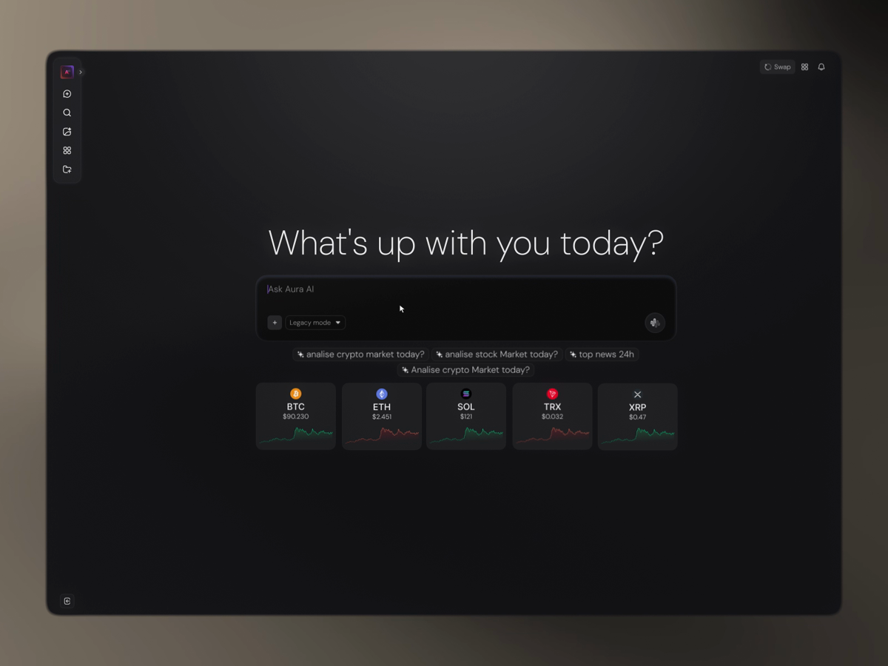
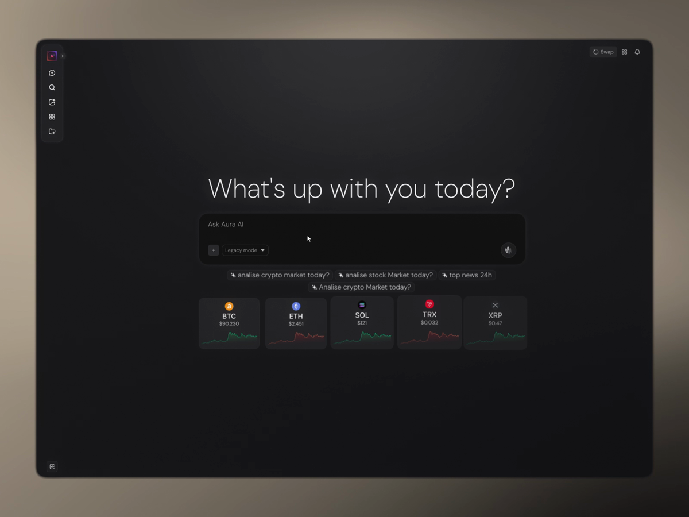
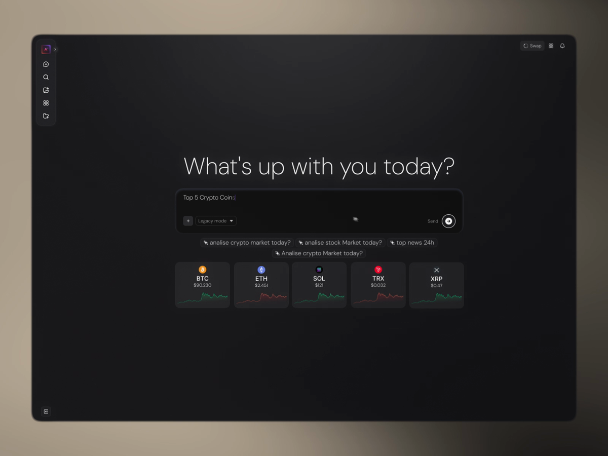
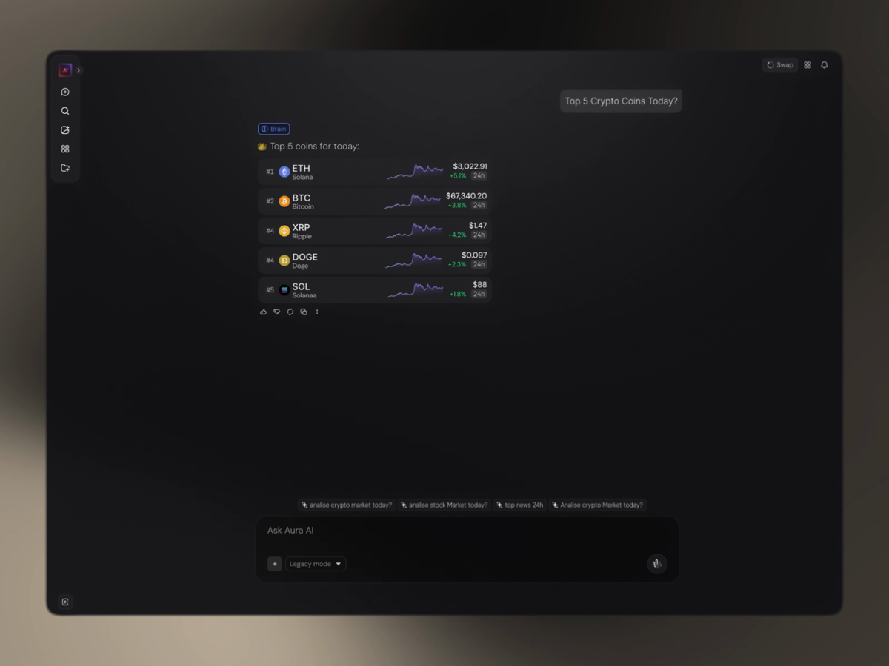
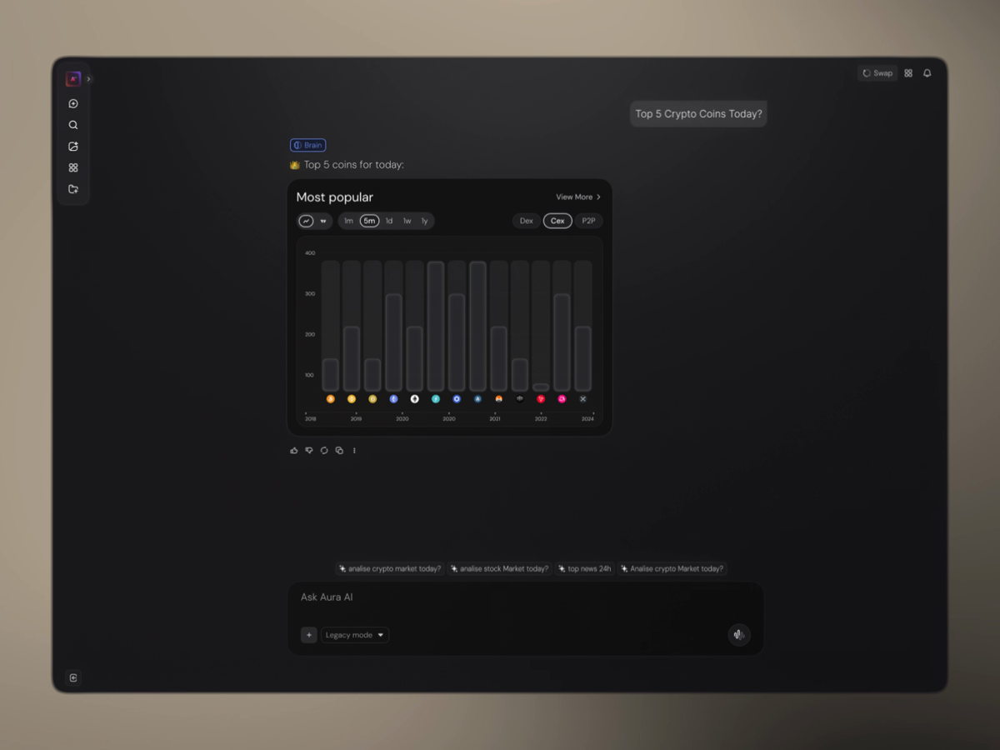

# Astra UI — Codex Build Brief (Design, Motion & Behavior)

**Audience:** Codex (the implementing agent) · **Companion:** [`astra-redesign-prd.md`](astra-redesign-prd.md) · **Date:** 2026-06-18

This brief describes — in depth and in plain language — **what to build, how every piece should look and move, and exactly how every piece must behave.** It deliberately avoids exact pixel sizes, spacing values, and animation timings: you derive those by **matching the attached reference photos** and using good taste. Where behavior, wiring, or data flow is described, follow it **precisely** — that's what makes the app actually work, not just look nice.

---

## 0. Read this first — how to use this brief

**What you are building.** A complete, working web app called **Astra** — an executive AI operator chat interface for "RovaOS". It is a single dark, premium, minimal surface. The look and motion are modeled on the attached reference (a polished dark AI app called "Aura AI"), but the **content is Astra's domain**: calendar, email, meetings, and operations — never crypto. The headline feature is **animated confirmation cards** that appear when Astra books a meeting or sends an email.

**Two non-negotiable rules.**
1. **It must look and move like the reference photos** in `docs/assets/` — the same calm, dark, spacious, cinematic feel; the same layout rhythm; the same quality of motion.
2. **Everything must actually function.** Every button does its job, typing works, new chat works, sending works, the sidebar opens, settings save, etc. A beautiful screen where buttons do nothing is a failure.

**How to treat measurements.** This document gives you *intent and behavior*, not numbers.
- **Visuals (size, spacing, radius, exact colors, layout proportions):** match the reference photos. Use your judgment. Do **not** ask for pixel specs — derive them by comparing your build to the images.
- **Motion (durations, easings, spring stiffness):** match the *feeling* described. Tune by eye until it feels like the reference (smooth, soft, premium, never janky or abrupt).
- **Behavior, wiring, data flow, the WebSocket protocol, tool input/output shapes:** these are exact contracts. Follow them to the letter. The exact design tokens (color hex values, the immutable protocol, and tool I/O schemas) live in the **PRD** — use them as anchors, but the *experience* is defined here.

**The iteration mandate (important).** Do **not** stop when the code compiles or the page renders. You must **iterate in a loop**:

> build → run the dev server → take a screenshot → open the reference frames in `docs/assets/` → compare side by side → fix the gaps (layout, color, spacing, motion, missing interactions) → repeat.

Keep going until **(a)** the app visually reads like the reference photos and **(b)** every interaction in §6 actually works and every animation in §5 is present and smooth. Treat the reference images as the source of truth for "is it done yet?". When in doubt, make it look more like the photos and make more things work.

**Tech stack (fixed):** React 19 + Vite + Tailwind CSS v4 + Framer Motion (`motion`). Icons: `lucide-react`. No other UI/component library. The build output is served by the RovaOS backend as static files, so it must build cleanly with `npm run build`.

---

## Build tooling & libraries — use only what genuinely helps

These few dependencies earn their place for *this* build. **Add nothing else unless you hit a concrete need** — every extra library is weight and decision overhead, and prefer the platform (CSS, SVG, Web APIs) over a package when it's close. (Versions current as of mid-2026; check before installing.)

**Use these (core):**
- **`motion`** (Motion, formerly Framer Motion; import from `motion/react`) — the animation engine for entrances, the home→conversation transition, the hero-card choreography, layout transitions, and `useReducedMotion()`. Non-negotiable for the headline motion.
- **`tailwindcss` v4 + `@tailwindcss/vite`** — utility CSS to match the reference fast; declare the dark tokens in an `@theme` block.
- **`lucide-react`** — the line-icon set (rail, chips, cards, toolbar). Consistent, tree-shakeable. The only icon source — no emoji.
- **`react-markdown` + `remark-gfm`** — render the assistant's answer text **safely** (builds a syntax tree, no `dangerouslySetInnerHTML`; GFM tables/lists/strikethrough). Do not hand-roll markdown; do not use innerHTML.
- **`date-fns`** — parse/format the ISO times from the calendar/email tools into human strings ("Tue · 2:30–3:00 PM · 30m"). Lightweight; avoid moment.js.
- **`clsx` + `tailwind-merge`** (a tiny `cn()` helper) — clean conditional Tailwind class composition.

**Optional (only if it clearly improves the feel):**
- **`@number-flow/react`** — animated rolling numbers; nice for the home-card counts and the calendar date-tile number. Skip if it complicates anything.
- A syntax highlighter (`rehype-highlight` or Shiki) — **only** if assistant answers regularly contain code blocks worth highlighting. Otherwise skip.

**Do NOT add (would bloat / fight the design):** a component kit (shadcn/MUI/Chakra) — the look is bespoke and dark, a generic kit fights it; a state manager (Redux/Zustand) — React context is enough here; a charting lib — v1 cards need no charts (a home sparkline, if any, is a small hand-drawn SVG); date pickers, form libraries, etc.

**Build/verify loop (this is how you satisfy the iteration mandate in §8):** run the Vite dev server and drive a **real screenshot loop** against `docs/assets/`.
- If your runtime has a **browser-preview tool/MCP** (start dev server, screenshot, read console logs, click, resize), use it: start → screenshot → compare to the frames → fix → repeat, and use it to catch console errors and exercise interactions (New chat, type, send).
- Otherwise use **Playwright** (headless Chromium) in a tiny script to screenshot each screen/state at a wide and a narrow width and compare to the frames.
- Use whatever your runtime actually has — *don't pull in tooling you can't run.* (Inside Claude Code: the Preview MCP plus the `frontend-design`, `animate`, and `critique` skills are directly useful. As Codex over a shell: Playwright + the dev server.) Either way the loop is non-optional: declare "done" from a screenshot that matches, never from reading code.

---

## 1. Reference imagery (attached — study these)

> The reference app is a crypto product. **Copy the aesthetic, the layout rhythm, and the motion quality. Do not copy its content.** Astra shows calendar/email/ops, not coins. Wherever the reference shows a coin list or a price chart, picture an Astra equivalent (a meeting card, an email confirmation, a tool chip) in the same visual language.

**1.1 — Home / empty state.** The screen you land on with no conversation yet.

Take from this: the near-black canvas with a soft warm vignette around the edges; the **slim left icon rail**; the small app glyph at the top of the rail; the discreet top-right controls; the **large, thin, centered hero line**; the wide, softly-bordered **search/composer box** with a muted placeholder and a small control cluster inside it; the **row of small suggestion chips** beneath; and the **row of cards** at the very bottom. Note how much empty space there is — it breathes.

**1.2 — Typed state.** The user has typed into the box.

Take from this: when the box has text, a **filled circular Send button** appears at the bottom-right of the box (replacing the idle voice/mic affordance), with a subtle "Send" label. The composer reacts to input.

**1.3 — The signature transition.** Sending animates the whole view.

Take from this: submitting a message does **not** hard-cut. The home view **scales/zooms** (a smooth cinematic push, slight perspective) as it gives way to the conversation. This transition is part of the premium feel — replicate a tasteful version.

**1.4 — Conversation with a rich answer.** After the transition.

Take from this: the **user's message** sits as a small bubble aligned to the right; the **assistant's answer renders as a rich, structured component** (not just plain text) — here a ranked list with icons, mini sparklines, and values; a small **action toolbar** sits beneath the answer (copy, retry, share, like, more); the **composer is now docked at the bottom**; and the suggestion chips remain just above it.

**1.5 — The quality bar for inline components.** The assistant can render fully-realized interactive widgets.

Take from this: the **polish ceiling** for Astra's inline cards. Astra's `CalendarCard`, `EmailCard`, and `ToolChip` should feel this considered — clean headers, tidy rows, soft separators, gentle internal motion — but in Astra's domain.

---

## 2. Art direction — the feeling

Describe the mood you are aiming for, then chase it:

- **Dark, calm, cinematic, premium.** A quiet, high-end operator console — not a busy dashboard. Lots of negative space. Nothing shouts.
- **Canvas:** near-black charcoal, with a soft, warm, neutral vignette/glow at the edges so the surface feels like it floats on a desk (see how the reference window sits on a warm background with a soft drop shadow). The app itself can render that ambient glow behind its own frame.
- **One accent, used sparingly:** a soft **violet/indigo**. It appears on the text cursor, the active rail item, the Send button, focus rings, and the success accents on hero cards. Everything else is grayscale on charcoal. Resist coloring things "just because."
- **Surfaces:** slightly lifted charcoal panels with **hairline borders** (barely-there light lines), soft rounded corners, and gentle depth (a whisper of shadow/blur, not heavy glass). Elevation is communicated by subtle lightening, not big shadows.
- **Type:** the hero line is **large and thin-weight**, almost editorial, in soft off-white, tightly tracked. Body text is comfortable and quiet; secondary text is muted gray. No decorative fonts.
- **No emoji anywhere.** Status and meaning come from clean line icons (lucide) and color, never from emoji glyphs. (The old app injected a "⚠️" into error text — do not do that; see §4.15.)
- **Restraint over decoration.** When unsure, remove rather than add. Premium = fewer, better elements.

Exact color hex anchors live in the PRD's token block; you may start from those, but **final colors are whatever best matches the reference frames.**

---

## 3. The shell and the two screens

**3.1 The window/shell.** The app fills the viewport. Conceptually it is: a **slim icon rail pinned to the left edge**, and a large **main area** to its right. The main area holds either the **Home** screen or the **Conversation** screen, with the **composer** living inside it (centered on Home, docked to the bottom in Conversation). The top-right corner stays mostly empty and clean.

**3.2 Two states.**
- **Home** — shown when the active conversation has no messages. Centered hero greeting + composer + suggestion chips + a row of "your day" cards.
- **Conversation** — shown once there are messages. A scrolling column of messages with the composer docked at the bottom.

**3.3 The signature transition between them.** When the user sends the first message from Home, animate the change of state (don't hard-swap). Mirror the reference: the Home content **scales/recedes** (a soft zoom with a touch of fade) while the Conversation surface comes forward. Likewise, returning to Home (e.g., "New chat") should ease in, not snap. Keep it quick and smooth — cinematic, not slow.

---

## 4. Component-by-component

For each component below: **what it is**, **how it looks** (descriptive), **its anatomy**, **its states**, **what each interaction does** (this is the functional contract — implement it), and **its motion**.

### 4.1 App shell / ambient frame
- **Look:** the dark canvas with the soft ambient vignette behind the app frame, exactly as the reference window floats on a warm backdrop.
- **Behavior:** responsive. On a wide screen, rail + main sit side by side. On a narrow screen (phone-ish width), the rail collapses to a single floating menu button at the top-left, and the sidebar (when opened) slides in as an overlay above a dimming scrim.
- **Motion:** none beyond the children; the ambient glow may breathe *very* subtly or stay static.

### 4.2 Icon rail (left edge)
- **What it is:** a permanent, narrow vertical strip of icon buttons — the primary navigation. (Reference 1.1, far left.)
- **Look:** thin, dark, quiet. At the **top**, a small rounded **app glyph** ("A" / Astra mark, with the violet→indigo tint) and a little chevron beside/under it that hints "expand." Below, a column of monochrome line icons with comfortable spacing. One icon pinned at the **bottom**.
- **Anatomy & what each does (wire all of these):**
  - **App glyph + chevron → expand/collapse the sidebar** (§4.3). Clicking toggles the full sidebar open/closed. This is the primary expand control.
  - **New chat** (plus icon) → starts a fresh, empty conversation: clears the active conversation selection so the Home screen shows, ready for a new first message. Does **not** delete anything.
  - **Search** (magnifier) → expands the sidebar (if collapsed) and focuses its search field (§4.3).
  - **History/Chats** (a chat/list icon) → expands the sidebar showing the conversation list.
  - **Settings** (gear, pinned at the bottom) → opens the Settings modal (§4.16).
  - *(Optional extra icons can exist for visual parity with the reference, but every icon you render MUST do something real — no dead icons. If you don't have a real action for an icon, don't render it.)*
- **States:** each icon has a quiet idle state, a **hover** state (it brightens and shows a small tooltip label), and an **active** state for the current view (a soft violet-tinted pill behind the icon).
- **Motion:** hover brightens/scales the icon a touch; tooltips fade in on hover; the active pill slides between items if you change selection.

### 4.3 Expandable sidebar
- **What it is:** the full navigation panel that slides out from the rail — conversation history, search, and the account row. (See the old concept's left panel for the *content*; render it in the new dark theme.)
- **Look:** a charcoal panel, hairline border on its right edge, sitting beside/over the rail. Header shows the **Astra wordmark** and a collapse control. Below: a prominent **"New chat"** button, a **search field**, then the **scrollable list of conversations**, and an **account row** pinned at the bottom.
- **Anatomy & what each does:**
  - **New chat button** → same as rail "New chat": go to a fresh Home/empty conversation.
  - **Search field** → filters the conversation list live as you type (case-insensitive match on titles). Empty query shows all. No results shows a quiet "No matches".
  - **Conversation list item** → click **selects** that conversation and shows it in the main area (and closes the overlay on mobile). The active item is visually highlighted. **Double-click** a title → enters inline **rename** mode (an input with the current title; Enter or blur commits, Esc cancels). Hovering an item reveals a **delete** (trash) button → deletes that conversation (if it was the active one, fall back to Home; if it's mid-stream, stop the stream first).
  - **Collapse control** (header) and the rail chevron → collapse the sidebar back to just the rail. Persist the expanded/collapsed choice so it survives reload.
  - **Account row** (bottom; avatar + name) → opens Settings.
- **States:** expanded vs collapsed; list empty ("No chats yet") vs populated; an item idle/hover/active/renaming.
- **Motion:** the panel **slides and widens** open (and reverses closed) smoothly; the main area eases to accommodate it. List items fade/stagger in when the panel opens. Rename input appears in place.

### 4.4 Home — hero greeting
- **What it is:** the centered headline that greets the user. (Reference 1.1, center.)
- **Look:** large, thin, soft-white, centered, tightly tracked — editorial and calm. A quieter secondary line can sit beneath it.
- **Content:** a **time-aware greeting using the principal's name** — "Good morning, Rohan." / "Good afternoon, Rohan." / "Good evening, Rohan." (the name is a single configurable constant, default "Rohan"; pick morning/afternoon/evening by the local hour). A short muted subline like "What should we tackle first?".
- **Motion:** on Home appearing, the greeting **fades up** gently, a beat before the composer and chips (a soft staggered entrance for the whole Home cluster).

### 4.5 Composer (the input) — used on Home and docked in Conversation
- **What it is:** the text box where the user talks to Astra. The **same component** is centered & larger on Home, and docked at the bottom in Conversation. (Reference 1.1/1.2 for Home; 1.4 for docked.)
- **Look:** a wide, softly-rounded, lifted charcoal box with a hairline border and a faint inner glow on focus (violet). Placeholder reads **"Ask Astra anything…"** in muted text, with a violet text caret. Inside the box, a small control cluster: a **"+" attach** button (and optionally a small mode pill like the reference's "Legacy mode ▾"), and at the bottom-right an affordance that is a **voice/idle glyph when empty** and becomes a **filled circular Send button (up-arrow)** once there's text (Reference 1.2).
- **Anatomy & what each does (wire precisely):**
  - **Text area** → the user types here. It **auto-grows** with the content up to a sensible max height, then scrolls internally. It must feel instant.
  - **Enter** → sends the message. **Shift+Enter** → inserts a newline (does not send). Sending clears the box and resets its height.
  - **Send button** → sends (same as Enter). It is **disabled/hidden when the box is empty** or when the app isn't ready (no backend/key) or while a response is streaming.
  - **While streaming**, the Send button becomes a **Stop** button (a square) that aborts the in-flight response.
  - **"+" attach** → opens a file picker (images, pdf, text-like files). Selected files appear as **removable chips above the input** (image files show a small thumbnail). A chip's **×** removes it. Attachments send along with the next message.
  - **Disabled state** (app not ready): the box is visibly muted and read-only; clicking it opens Settings (so the user can connect).
- **Motion:** the box lifts slightly and its border/glow warms on focus; the Send button **springs in** when the first character is typed and **springs out** when the box empties; attachment chips animate in/out; the whole composer smoothly relocates from center (Home) to bottom (Conversation) as part of the §3.3 transition.

### 4.6 Suggestion chips
- **What they are:** a row of tappable prompt suggestions under the composer on Home. (Reference 1.1/1.4, the small pills with a tiny leading icon.)
- **Look:** small, quiet pills with a hairline border and a tiny leading line-icon; muted text. They wrap to a second centered row if needed, like the reference.
- **Content (Astra prompts, no emoji):** "What's on my calendar today?", "Triage my unread inbox", "Schedule a meeting", "Run my morning briefing". (These are sensible defaults; keep them editable in one place in code.)
- **What they do:** clicking a chip **sends that exact prompt** as a message (triggering the Home→Conversation transition).
- **Motion:** chips **stagger in** after the hero; hover lifts the border and nudges the chip slightly.

### 4.7 Home cards — "your day" row
- **What it is:** the bottom row of cards on Home. In the reference these are live crypto tickers; **for Astra they are your day at a glance.** (Reference 1.1, bottom row.)
- **Look:** a horizontal row of softly-bordered charcoal cards, each with a small icon/label, a primary value, and a hint of supporting detail — same visual rhythm as the reference's coin cards (icon on top, label, value, a small lower detail), minus the sparkline unless you have data for one.
- **Behavior (hybrid — implement both paths):**
  - On Home mount, request the day summary from the backend (`GET /api/home`, see PRD §7). Show a brief **skeleton shimmer** while loading.
  - **If live data is available**, render: **Next** (the next meeting — subject + time), **Today** (count of today's events), **Inbox** (unread count). Clicking a card sends a relevant prompt (e.g., Next → "What's my next meeting about?", Today → "What's on my calendar today?", Inbox → "Triage my unread inbox").
  - **If the backend is unreachable, says unavailable, errors, or is slow (short timeout)**, silently fall back to **static quick-action cards** (Calendar / Inbox / Briefing) that each send a prompt when clicked. **No error noise on Home** — it should always look intentional.
- **States:** loading (skeleton), live, static-fallback. Each card has idle/hover.
- **Motion:** cards **stagger/fade up** as the last part of the Home entrance; skeleton shimmer while loading; hover lifts the card subtly.

### 4.8 Conversation surface
- **What it is:** the scrolling column of messages shown once a conversation has content. (Reference 1.4/1.5.)
- **Look:** a centered, comfortably-margined column on the dark canvas. User and assistant messages alternate. The docked composer floats at the bottom with the suggestion chips just above it; content scrolls *behind/under* the composer area with enough bottom breathing room that the last message is never hidden behind it.
- **Behavior:** **auto-scrolls to the newest content** as a response streams in, but only when the user is already near the bottom (if they've scrolled up to read history, don't yank them down). Switching conversations jumps to the bottom without animation.
- **Motion:** new messages **fade/slide up** as they appear; streaming text appends smoothly; the auto-scroll is smooth, not jumpy.

### 4.9 User message
- **Look:** a compact bubble **aligned to the right**, a slightly lifted charcoal with a soft rounded shape (see the reference's right-aligned user bubble). No avatar. If the message had attachments, they appear inside/with the bubble (image thumbnails or file chips). A small, very quiet timestamp may sit beneath.
- **Behavior:** static once sent.
- **Motion:** appears with a gentle fade/slide-up.

### 4.10 Assistant message + action toolbar
- **What it is:** Astra's reply. It is a **left-aligned, avatar-less** flow that can contain: tool activity (chips/cards, §4.12–4.14), then the final answer text (clean, readable markdown — bold, lists, code, links; rendered safely, never via raw HTML injection), and a **message action toolbar** beneath it. (Reference 1.4/1.5 show the toolbar of small icons under the answer.)
- **Action toolbar — wire these (functional):**
  - **Copy** → copies the answer's text to the clipboard (show a brief "Copied" affordance).
  - **Retry / regenerate** → re-sends the preceding user message to produce a new answer.
  - **Share** → a small action; at minimum copy a shareable text version of the message (a real, working behavior — not a dead button).
  - **Thumbs up / thumbs down** (optional) → toggle a local "feedback" state on the message (visual only is acceptable, but it must visibly respond).
  - Keep the toolbar quiet — it fades in on hover of the message (or is always faintly visible) and brightens on hover of each button.
- **States:** thinking (no text yet → show the typing indicator §4.11), streaming (text growing), done (toolbar available), error (§4.15), stopped (a quiet "Stopped" tag).
- **Motion:** the typing indicator gives way to streaming text; toolbar buttons have hover/press feedback; any inline cards animate per §5.

### 4.11 Thinking / typing indicator
- **Look:** a small, calm animated indicator (e.g., three soft pulsing dots) shown while Astra is working and has not yet produced text or a card.
- **Motion:** a gentle, looping pulse; it disappears the moment real content arrives.

### 4.12 Generic tool chip (for all ~93 non-hero tools)
- **What it is:** the standard way **every tool that isn't a calendar booking or an email send** is shown — searches, lookups, reads, digests, reminders, etc. One consistent, collapsible element. (Mentally: the reference's tidy rows, reduced to a single line.)
- **Look:** a single quiet row: a small status dot/icon on the left, a **human-readable title** describing the action, and a **one-line result summary** — with a chevron to expand. Never show raw JSON in the collapsed state.
- **Title humanization (do this):** map tool names to friendly phrases — e.g. "Searched inbox", "Checked calendar", "Checked availability", "Searched the web", "Set a reminder", "Drafted an email", "Replied", "Ran morning briefing". For anything unmapped, prettify the tool name (snake_case → Title Case). (The PRD lists the concrete mapping.)
- **Result summary (do this):** condense the tool's result to one line — e.g. "7 results", "Tue 2–4 pm free", a status word — never a JSON dump.
- **States:** **running** (a spinner, "working…"), **done** (a settled accent dot + the summary), **error** (a danger dot; the reason shows on expand). Expanded reveals the tidy details (the arguments and a readable view of the result).
- **What it does:** clicking the row **expands/collapses** the detail. That's its only interaction.
- **Motion:** spinner while running; on completion the dot settles; expand/collapse animates the height smoothly with the chevron rotating.

### 4.13 CalendarCard (HERO — `create_calendar_event`)
- **What it is:** the celebratory confirmation that Astra **booked a meeting / added an event**. This is one of the two headline components. It renders **once the action is confirmed** (the tool result has arrived). (Quality bar: Reference 1.5.)
- **Look:** a refined card with a clear header — a small **date tile** (month + day), the title ("Meeting booked" when there are attendees or it's an online meeting; "Event added" otherwise), and a **drawn checkmark** that signs off success. Below: the **when** (day, time range, duration), the **where** (location or an "online/Teams" badge when it's a virtual meeting), and — **only if there are attendees** — a compact **attendee row** (small avatars/initials + names). Calm, tidy, premium.
- **Data:** the rich content (subject, start/end, attendees, online?) comes from the tool **call input**; the success/confirmation (it really happened, the event id) comes from the tool **result**. (Exact shapes in PRD §11.) Render the attendee row **only when attendees exist** — this single card serves both "meeting" and "event".
- **States:** **success** (the normal animated confirmation) and **error** (if the result indicates failure: a restrained danger treatment, "Couldn't book — <reason>", no celebratory checkmark).
- **Motion (see §5 for the full choreography):** the card **arrives with a soft spring and a gentle accent glow**, the **checkmark draws itself on**, the detail rows **cascade in**, and a **signature touch**: the date tile **fills in**. Plays **once** on appearance.

### 4.14 EmailCard (HERO — `send_email`)
- **What it is:** the confirmation that Astra **sent an email**. The second headline component. Renders once the send is confirmed.
- **Look:** a refined card with an **envelope/mail glyph**, the title "Email sent", and a **drawn checkmark**. Below: **To** (recipients, collapsing extras into "+N"), the **subject**, a **1–2 line preview** of the body, and a small **importance** tag only when it's high/low.
- **Data:** content (to, subject, body, cc, importance) from the call input; "sent" confirmation from the result. (PRD §11.)
- **States:** success and error (mirror CalendarCard's error treatment: "Couldn't send — <reason>", no checkmark).
- **Motion (see §5):** soft spring arrival + glow, **checkmark draws on**, details cascade, and a **signature touch**: a thin accent **"seal/send" sweep** glides across the top of the card once. Plays once.

### 4.15 ErrorNote (no emoji)
- **What it is:** how errors are shown inline — replacing the old habit of jamming a "⚠️" into the text.
- **Look:** a restrained, danger-tinted note with a clean warning line-icon and the message text in a hairline chip. Quiet, legible, never alarming-by-decoration.
- **Behavior:** when a response fails, the assistant message shows an ErrorNote with the real reason (e.g., a bad API key message, a connection failure). Do **not** concatenate emoji into message text.
- **Motion:** fades in gently like any other block.

### 4.16 Settings modal
- **What it is:** a centered modal for configuration. (Functionally similar to the current app's settings; restyle to the dark theme.)
- **Look:** a centered dark panel over a dimming scrim, hairline border, a header with a title and a close (×).
- **Contents & what each does (wire precisely):**
  - **Connection toggle:** "Local RovaOS" vs "Anthropic key" — switches which backend Astra talks to.
  - **Backend URL** (RovaOS mode): a text field for the server URL with a **"Test"** button that pings the backend health endpoint and shows a clear OK/❌-with-reason note (no emoji — use words/icons).
  - **Anthropic API key** field (with show/hide eye toggle): stored only in the browser. *(Note: you, Codex, never need a real key to build or to run the gallery; the user supplies it at runtime.)*
  - **Model** select (Anthropic mode).
  - **Preview a booking** (dev/demo action): injects a synthetic CalendarCard and a synthetic EmailCard into the current conversation so the hero animations can be seen without any backend (see §4.17 and §5).
  - **Clear all conversations** (destructive): confirms, then wipes stored conversations.
- **Behavior:** opens from the rail/sidebar/account/disabled-composer; closes on ×, on scrim click, and on Esc.
- **Motion:** scrim fades; panel springs/scales in softly; reverses on close.

### 4.17 Card gallery (`?gallery`) + Preview-a-booking
- **What it is:** a **developer harness** so the hero animations can be built and tuned with **zero backend**. This is how *you* (Codex) iterate on motion.
- **Behavior:** if the URL has a `?gallery` query parameter, render a **gallery page** instead of the app. The gallery shows every card in every state — CalendarCard (with attendees / without attendees / error), EmailCard (sent / high-importance / error), the generic ToolChip (running / done / error), and the ErrorNote — each with a **"Replay"** button that re-mounts the component to replay its entrance animation. Use realistic sample data.
- **Preview-a-booking:** the Settings action (§4.16) calls a helper that pushes a synthetic assistant message containing a completed CalendarCard or EmailCard into the live conversation, so the card can be seen animating **inside a real chat flow** — again with no backend and no real side effects.
- **Why it matters:** M365 may be unauthed locally and real sends have real consequences. The gallery + preview let you perfect the motion safely. **Use them as your iteration surface for §5.**

---

## 5. Motion language (the headline) — described, not numbered

Motion is what makes Astra feel premium. Build it with Framer Motion. **Tune everything by eye against the reference until it feels smooth, soft, and intentional.** Numbers are yours to choose; the *feeling* is specified.

**5.0 Global principles.**
- Prefer **spring-based** motion with a soft landing (a hint of overshoot, then settle) over linear/abrupt tweens.
- Motion is **purposeful** — it explains a change (something arrived, expanded, succeeded), never decoration for its own sake.
- **Everything degrades** under the OS "reduce motion" setting: replace movement/drawing with a simple, quick fade. Honor `prefers-reduced-motion` everywhere.
- Nothing janky. If a transition stutters, slow it slightly or simplify it. Smoothness beats flashiness.

**5.1 Home entrance.** When Home appears, its parts arrive in a gentle **staggered cascade**: greeting first (fade up), then the composer, then the suggestion chips, then the "your day" cards. It should feel like the screen settling into place, calmly.

**5.2 Home → Conversation transition (signature).** On the first send, the Home cluster **scales/recedes with a soft fade** (a cinematic push, faint perspective, like the reference) while the Conversation surface comes forward and the composer **glides from center to docked-bottom**. Quick, smooth, one continuous feeling — not a hard cut. Returning to Home (New chat) eases back in.

**5.3 Streaming a reply.** The typing indicator pulses while Astra thinks; when text starts, it **appends smoothly** (no layout jank as it grows); tool chips/cards appear in order as their events arrive; the view keeps the newest content in view (smart auto-scroll, §4.8).

**5.4 Hero card choreography (CalendarCard & EmailCard).** When a hero card appears (on confirmation), play this sequence **once**, smoothly:
1. **Arrival:** the card eases in with a soft spring (a small scale-up + lift) and a brief, gentle **accent glow** that blooms and settles.
2. **Checkmark draws on:** the success check **strokes itself in** (an SVG path that draws), as if Astra is signing off the action. (Under reduced motion, the check simply appears.)
3. **Details cascade:** the rows (when/where/attendees, or to/subject/preview) **fade up in a quick stagger**, one after another.
4. **Signature touch (one per type):**
   - **EmailCard:** a thin accent **"seal/send" sweep** glides once across the top edge — the feeling of an envelope being sealed and sent.
   - **CalendarCard:** the **date tile fills in** (a soft fill rising into the tile) as the day settles — the feeling of a slot being claimed on the calendar.
5. **No confetti, no particle bursts.** Keep it executive-grade and restrained.

**5.5 Generic tool chip.** A small spinner while running; on completion the status dot **settles** and the summary appears; expand/collapse animates the **height smoothly** with the chevron rotating.

**5.6 Micro-interactions — the small responses that make it feel alive.**
Every interactive element should *acknowledge* the user instantly with a small, soft, spring-eased response. None are loud; together they are most of the "premium" feeling. All are subtle and all are reduced/disabled under reduce-motion. Build these everywhere:

- **Every button:** on hover, brighten and lift a hair; on press, depress slightly (a small scale-down) then spring back on release; on keyboard focus, a soft violet ring fades in. Disabled buttons don't react at all.
- **Rail icons:** hover brightens the icon and floats in a small label tooltip; the active item carries a violet-tinted pill that **slides** smoothly to the new item when the view changes; press gives a tiny depress.
- **Composer:** focusing the box warms its border and blooms a faint violet inner glow; the **Send button springs in** the instant the first character is typed and **springs out** when the box empties; Send↔Stop crossfade while streaming; the box height eases as it grows/shrinks with text; attachment chips pop in and shrink out.
- **Suggestion chips:** hover lifts the border and nudges the chip up slightly; press depresses; on click the chip briefly highlights as it fires the prompt.
- **Home cards:** hover lifts the card and lightens its surface a touch; a shimmer sweeps the skeleton while loading; live numbers can roll up on first appearance (NumberFlow, if used).
- **Conversation list items:** hover lightens the row and fades in the delete button; the active item holds a steady highlight; entering rename swaps the title for an inline input in place; deleting collapses the row out.
- **Sidebar:** expand/collapse slides and widens the panel while the main area eases alongside; the panel's contents stagger in as it opens.
- **Message action toolbar:** fades in on message hover; each icon brightens on hover; **Copy** briefly swaps to a check/"Copied" state then reverts; **Retry** spins its icon once as it fires; thumbs toggle with a small pop.
- **Tool chip:** the running spinner rotates; on completion the status dot settles with a small pop into the accent color; the chevron rotates and the height eases as it expands/collapses.
- **Hero cards (beyond the §5.4 entrance):** the online/Join badge and attendee avatars get gentle hover states; the drawn checkmark gives one subtle settle.
- **Modal:** the scrim fades in; the panel scales/springs from slightly small; Esc or scrim-click reverses it.
- **Scrolling:** auto-scroll to newest content glides; if the user scrolls up during streaming, a subtle "jump to latest" affordance fades in and eases them back down on click.
- **Global feel:** entrances ease *out* (fast, then settle); keep everything short; never block input waiting on an animation; if anything reads janky, simplify it rather than slow it.

---

## 6. Functional behavior catalog — make it REAL

Every interactive element and exactly what it must do. **If you render it, it must work.** No dead controls.

| Element | Action when used |
|---|---|
| Composer text area | Type freely; auto-grows with content; placeholder "Ask Astra anything…" |
| Enter | Send the message |
| Shift+Enter | Newline (do not send) |
| Send button | Send (only enabled with text + ready + not streaming) |
| Stop button (while streaming) | Abort the in-flight response |
| "+" attach | Open file picker; add removable attachment chips |
| Attachment chip × | Remove that attachment |
| Suggestion chip | Send that exact prompt |
| Home card (live) | Send the card's relevant prompt (Next/Today/Inbox) |
| Home card (static fallback) | Send the quick-action prompt |
| Rail · app glyph/chevron | Toggle the sidebar open/closed (persist) |
| Rail · New chat | Go to a fresh empty Home conversation |
| Rail · Search | Open sidebar + focus search field |
| Rail · History | Open sidebar showing conversation list |
| Rail · Settings | Open Settings modal |
| Sidebar · New chat | Fresh empty Home conversation |
| Sidebar · search field | Live-filter conversation list (case-insensitive) |
| Conversation list item (click) | Select & show that conversation |
| Conversation item (double-click title) | Inline rename (Enter/blur commit, Esc cancel) |
| Conversation item (hover → trash) | Delete that conversation (stop stream if active; fall back to Home if it was active) |
| Sidebar collapse / rail chevron | Collapse sidebar to rail (persist) |
| Account row | Open Settings |
| Assistant · Copy | Copy answer text to clipboard (+ "Copied" feedback) |
| Assistant · Retry | Regenerate the answer for the preceding user message |
| Assistant · Share | Copy a shareable text version (real behavior) |
| Assistant · 👍/👎 (optional) | Toggle local feedback state (must visibly respond) |
| Tool chip row | Expand/collapse detail |
| Settings · Connection toggle | Switch backend (RovaOS ↔ Anthropic) |
| Settings · Test | Ping backend health; show OK/failure reason |
| Settings · key/model fields | Persist to browser storage |
| Settings · Preview a booking | Inject synthetic Calendar + Email cards into the chat |
| Settings · Clear conversations | Confirm, then wipe stored chats |
| Settings · close (×/scrim/Esc) | Close the modal |
| Gallery · Replay (per card) | Re-mount that card to replay its animation |
| Disabled composer (not ready) | Clicking it opens Settings |

**Keyboard:** Enter / Shift+Enter (composer), Esc (close modal / cancel rename). A ⌘K command palette is **not required** for v1 (don't add dead shortcuts).

---

## 7. Data & live behavior — so it works end to end

This is the wiring that makes the UI a real product. Follow it; exact protocol/shape details are immutable and live in the PRD (§7, §8, §11).

**7.1 Sending a message.** On send: append the **user message** and an **assistant placeholder** (in "thinking" state) to the active conversation (create the conversation if this is the first message; derive its title from the first user message). Open a WebSocket to the RovaOS backend for this conversation's session id and send the user's text (and the browser-held API key if present). Then handle the stream:
- **tool_call** event → upsert a tool block for that action (keyed by the tool's id) in "running" state. If it's a hero tool (`create_calendar_event` / `send_email`), keep it quiet for now (show the working indicator), because hero cards render on confirmation.
- **tool_result** event → update that block to "done" with its result. If it's a hero tool, **now render the CalendarCard/EmailCard** (it animates in once). Otherwise the generic chip shows its done state + summary.
- **response** event → the final answer text; mark the message done and reveal the action toolbar.
- **error** event → show an ErrorNote with the message.
- The **Stop** button aborts the socket/stream and marks the message "stopped".

> Today's backend only emits `tool_call` and `response`. The hero cards require it to also emit **`tool_result`** (and an `id` on `tool_call` so call and result can be matched). This is a small, additive backend change specified in the PRD §7. Build the client to consume `tool_result`; coordinate the backend change as part of making the cards real. The **gallery + Preview-a-booking** let you build and verify all card motion **before** that backend change lands.

**7.2 Home cards.** On Home mount, fetch the day summary (`GET /api/home`). Render live cards if available; otherwise the static fallback (§4.7). Never block or error the Home screen on this.

**7.3 Persistence & sessions.** Conversations and settings persist in browser storage and survive reload. **Guard storage access defensively** — in some environments `localStorage` exists but throws on access (private mode / sandboxed); a failure to read/write must **never** blank or crash the app (fall back to in-memory defaults). On load, **heal** any assistant message left mid-stream by a refresh (mark it done if it had text, else stopped). The conversation id doubles as the backend session id so the server keeps thread history.

**7.4 Backends.** Two modes via Settings: **RovaOS** (WebSocket to the local backend; the browser key is forwarded so the server can run without its own) and **Anthropic** (bring-your-own-key, stream directly from the browser). The UI is identical either way. "Ready to send" means: RovaOS mode is always ready; Anthropic mode is ready once a key is entered.

---

## 8. The iteration loop & definition of done

**8.1 The loop (do this repeatedly).**
1. Build the piece. Run the dev server.
2. Screenshot the relevant screen/state.
3. Open the matching reference frame(s) in `docs/assets/`.
4. Compare: layout proportions, spacing rhythm, color/contrast, type weight, the *feel*. List the gaps.
5. Fix the biggest gaps. For motion, use the `?gallery` route and replay until it feels right.
6. Repeat until it both **looks like the reference** and **behaves per §6**.

**8.2 What "done" means.** All four are true — verified by screenshot and by clicking, not by reading code:
- **Looks like the photos** (§1–§2): dark calm canvas, slim rail, thin centered hero, composer with Send-on-type, chips, "your day" cards, right-aligned user bubble, rich left-aligned assistant content + action toolbar, docked composer, the zoom transition, one sparing violet accent, **no emoji**.
- **Everything in §6 works** — every row of the functional catalog; New chat truly starts fresh; reload restores state and never crashes on blocked storage.
- **Motion is present & smooth** (§5) — home stagger, send transition, streaming + smart auto-scroll, the full hero-card choreography (verify in `?gallery`), the §5.6 micro-interactions, and **reduced-motion degrades to clean fades**.
- Astra still talks to RovaOS over the unchanged protocol (and BYOK still works); `npm run build` is clean.

**Verify every one of these by actually using the app in a browser — the full end-to-end test plan is §9. Keep iterating until all of it passes — don't stop early.**

---

## 9. End-to-end browser testing — simulate real use, test *everything*

**Mandate.** Before any of this is "done," you must **drive the running app in a real browser and actually use it** — dispatch real clicks, real keystrokes, real typing; take screenshots; read the console. Not jsdom unit tests, not "it compiles," not one static screenshot. Simulate a real person using Astra end to end, and confirm with your own eyes (screenshots) and assertions that **every** behavior in §6, **every** animation in §5, and **every** screen in §1–§2 actually happens. When a step fails, fix the source and re-run. **Nothing is done until every scenario below passes in the browser.**

**How.** Use your runtime's browser driver — a preview/browser MCP (start dev server, click, fill, eval, screenshot, console logs, resize) if you have one, otherwise **Playwright** (headless Chromium) with a script that navigates, clicks by selector, types, waits, screenshots, and asserts. Run the suite at a **wide desktop width and a narrow phone-ish width**. After each scenario, **check the console** (zero errors) and **screenshot** to compare against the reference frames in `docs/assets/`.

**A. First paint / Home (zero backend).** Load the app; screenshot; compare to `ref-1-home.png` (dark canvas + vignette, slim rail, thin centered greeting, composer, chips, "your day" cards). Assert: no emoji in the DOM, no console errors. Confirm the home cards **fall back to static** with no backend — no error state, no infinite spinner.

**B. Composer, send, the signature transition.**
- Click the composer and type. Assert the **Send button springs in** (it was hidden when empty). Screenshot; compare to `ref-2-typed-send.png`.
- Press **Enter** → assert it sends (a right-aligned user bubble appears), the **home→conversation zoom transition** plays, and the composer is now **docked at the bottom**. Screenshot; compare to `ref-4-conversation-answer.png`.
- Type and press **Shift+Enter** → assert a newline is inserted and it did **not** send. Type several lines → assert the box **auto-grows**.
- While a reply is streaming, click **Stop** → assert the stream aborts and the message reads "stopped".

**C. Suggestion chips.** Click each chip → assert it sends exactly that prompt (user-bubble text matches) and triggers the transition.

**D. Hero animations (demo path — no backend, no real sends).**
- Settings → **Preview a booking** → assert a **CalendarCard** and an **EmailCard** appear in the chat and **animate**: card springs in, the **checkmark draws on**, details cascade, and the per-type signature plays (Email "seal/send" sweep; Calendar date-tile fill). Screenshot mid-animation and settled.
- Open **`?gallery`** → assert every card state renders (Calendar with/without attendees/error; Email sent/high/error; ToolChip running/done/error; ErrorNote). Click **Replay** on each → assert the entrance animation re-plays. This is your motion-tuning surface.

**E. Tool chips / streaming render.** Assert a non-hero tool renders as a chip with a humanized title + one-line summary, transitions running→done, and that clicking it **expands/collapses** the detail. (Use the real backend in H, or a demo/stub otherwise.)

**F. Rail + sidebar (every control).**
- Rail: click **New chat** (→ fresh Home), **Search** (sidebar opens + search field focused), **History** (list shows), **Settings** (modal opens). Assert each.
- Sidebar: **expand/collapse** via the rail glyph (and confirm it **persists across reload**); type in **search** → list filters live; **click** a conversation → it loads + highlights; **double-click** a title → rename input appears, **Enter** commits, **Esc** cancels; hover an item → **delete** appears, click → it's removed (and if it was active, falls back to Home). Assert each.

**G. Settings (every field).** Open it from rail / account / disabled-composer. Toggle **Connection** (RovaOS ↔ Anthropic). Enter a Backend URL and click **Test** → assert a clear OK note when reachable and a clear failure note when not (no emoji). Toggle key show/hide; change model. **Clear conversations** → assert a confirm step, then an empty state. Close via **×**, **scrim click**, and **Esc** → assert each closes it.

**H. End-to-end against the real backend (when reachable).** Hook up RovaOS (start the backend, set the URL): send "hi" → assert the WebSocket round-trip works and a real `response` renders. Send a prompt that triggers a tool → assert `tool_call` → `tool_result` drives a chip, and if it books/sends, the **real CalendarCard/EmailCard** appears. Also verify **BYOK Anthropic** mode streams a reply. *(If no backend/key is available in your environment, state that explicitly and rely on D/E — do not fake a pass.)*

**I. Persistence & resilience.** Create chats, **reload** → assert conversations + settings restored and any mid-stream message healed (no stuck spinner). Simulate **blocked localStorage** → assert the app still loads and works (never a blank screen). **New chat** → assert it truly starts empty and does not delete history.

**J. Reduced motion.** Emulate the OS "reduce motion" setting → re-run B and D → assert animations **degrade to simple fades** (no path-draw, sweep, or zoom) and the app stays fully usable.

**K. Responsive.** At narrow width: assert the rail collapses to a floating menu button, the sidebar opens as an **overlay with a scrim**, and nothing overlaps or clips. Screenshot.

**L. Global sweep.** Across all of the above: **no console errors/warnings**, **no emoji anywhere** in the rendered DOM, keyboard focus rings appear, and `npm run build` is clean.

**Testing is done when:** every scenario A–L has been executed by **actually clicking and typing in the browser** (evidenced by screenshots + assertions), every failure has been fixed and re-run, and the result matches the reference frames and §6. Do not report the build done until this is true.

---

## 10. Hard contracts (do not improvise these)

Pull exact values from the PRD; summarized here so you don't drift:
- **WebSocket protocol** with RovaOS (connect per conversation/session; send `{type:"message",text,api_key?}`; receive `tool_call`, `tool_result` *(new)*, `response`, `error`). Re-implement the client; do not change the wire shape. (PRD §7–§8.)
- **Tool I/O shapes** for `create_calendar_event` and `send_email` (and the humanized titles for the rest). (PRD §11.)
- **Backend additions** required to make hero cards real: emit `tool_result` + add `id` to `tool_call`; add `GET /api/home`. (PRD §7.)
- **Stack & build:** React 19 + Vite + Tailwind v4 + Framer Motion; build to static files the backend serves. (PRD §2.)
- **Exact design tokens** (color hexes, accent) as anchors — but final visuals match the reference. (PRD §4.)

---

*End of brief. The reference images in `docs/assets/` are the source of truth for "does it look right?"; §6 is the source of truth for "does it work?". Build, compare, refine — and don't stop until both are yes.*
